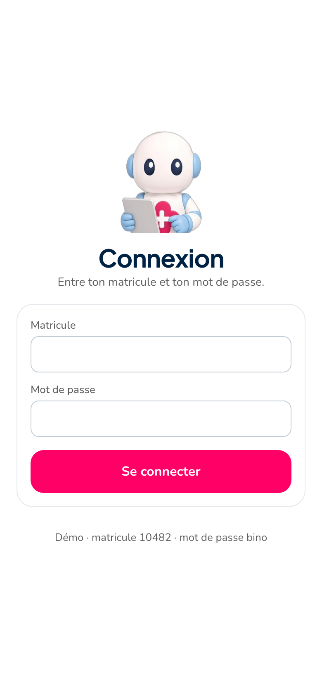
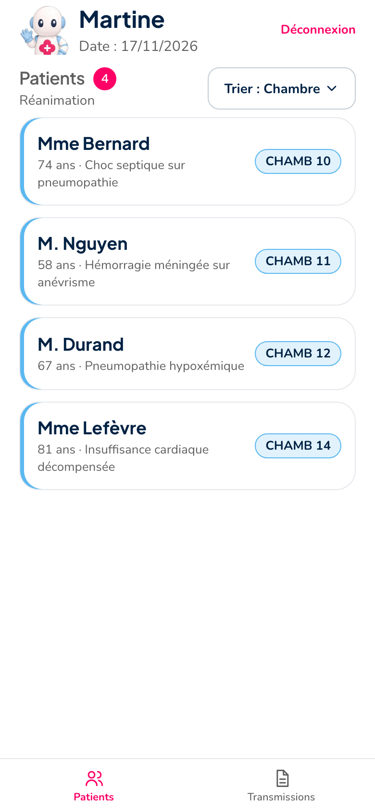
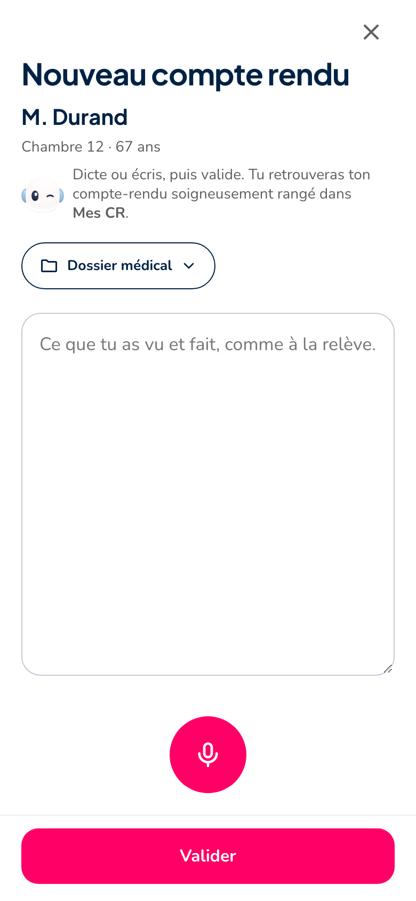
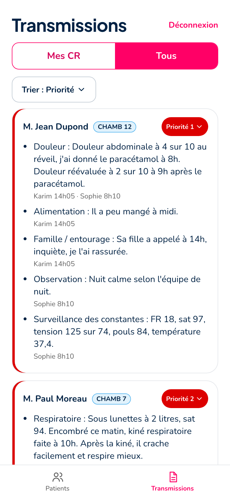

<h1 align="center">Bino</h1>

<p align="center">
  <em>Le binôme des infirmiers.</em>
</p>

<p align="center">
  
</p>

<p align="center">Rendre à Martine le temps que l'administratif prend aux patients.</p>

<p align="left">
  <a href="https://bino.noiseless-sunflower.workers.dev"><b>Essayer →</b></a>
</p>

Matricule `10482`, mot de passe `bino`. Patients fictifs.

<table>
  <tr>
    <td align="center" width="25%"><br><sub>Connexion</sub></td>
    <td align="center" width="25%"><br><sub>Patients</sub></td>
    <td align="center" width="25%"><br><sub>Compte rendu</sub></td>
    <td align="center" width="25%"><br><sub>Transmissions</sub></td>
  </tr>
</table>

## Lancer

```bash
npm install
npx expo start
```

- `w` ouvre l'app web.
- Expo Go (téléphone) : scanner le QR code.

SDK Expo 57, le SDK que Expo Go ouvre aujourd'hui pendant la transition vers le 58. Même code pour iOS, Android et le web.

```bash
npm run lint
npm test
npm run typecheck
```
