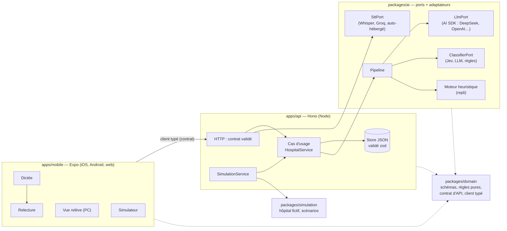
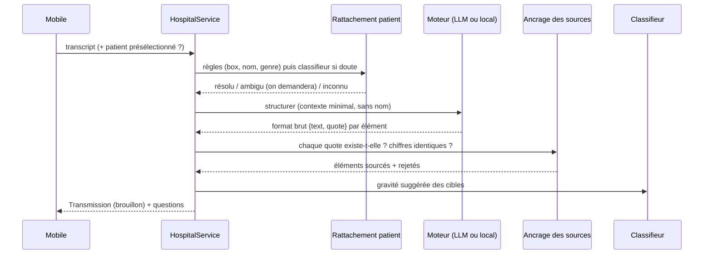

# Architecture

## Vue d'ensemble

## Paquets et règles de dépendance

| Paquet | Rôle | Dépend de |
| --- | --- | --- |
| `packages/domain` | Schémas zod, règles **pures** (ancrage, complétude, priorité, fiche, temps, FHIR, recherche), contrat d'API + client | zod |
| `packages/ai` | Ports IA, adaptateurs, pipeline de structuration. **Serveur uniquement** | domain |
| `packages/simulation` | Hôpital fictif + scénarios (données) | domain |
| `apps/api` | Composition : services, store, HTTP, simulateur, CLI | domain, ai, simulation |
| `apps/mobile` | UI | domain (types + client) |
| `e2e` | Playwright | domain (client) |

Les paquets internes exposent leur **source TypeScript** (`main: src/index.ts`) : pas d'étape de build,
Metro, Vitest et tsx les consomment directement.

## Contrat d'API typé

`packages/domain/src/api/contract.ts` déclare chaque endpoint (méthode, chemin, schémas zod des
paramètres, query, corps et réponse).

- **Serveur** : `registerContract()` enregistre tout, valide les entrées (400 lisible) **et les sorties**
  (une réponse hors contrat = 500 + log). Le type `Handlers` oblige à implémenter chaque endpoint.
- **Client** : `createApiClient()` génère `api.<nom>(input)` typé ; la réponse est validée à l'exécution.
  Une dérive mobile/serveur casse immédiatement avec un message clair, pas silencieusement.

## Pipeline IA d'une dictée

Points clés :

- **Format brut commun** (`engine/raw.ts`) : tous les moteurs renvoient `{ text, quote }`. Le LLM ne
  produit jamais directement ce qui est affiché.
- **Ancrage** (`domain/rules/grounding.ts`) : l'extrait doit être retrouvé dans la dictée (tolérance
  accents/ponctuation/petites fautes) et **tous les nombres** du texte doivent figurer dans l'extrait.
  Sinon : rejet, tracé dans `engine.rejected`.
- **Repli** : délai max (`LLM_TIMEOUT_MS`) puis moteur heuristique ; la transmission porte
  `engine.degraded = true`, l'UI le dit.
- **Complétude** déterministe : cible sans R → question. Les questions d'imprécision du LLM sont
  limitées et toujours formulées en questions.
- **Priorité** : règles explicables (`PRIORITY_WEIGHTS`) + gravité suggérée (Jev Score / LLM / lexique).
  Couleur manuelle et ★ priment toujours.
- **Fiche de relève** : assemblée sans IA à partir des transmissions structurées (fonctionne hors ligne).

## Temps

Tout est en heure locale du service via `Intl` (`rules/time.ts`), y compris sous Hermes.
`handoverWindow()` : pendant les 2 h qui suivent 7h45 / 19h45, on montre le poste qui vient de finir.
L'horloge peut être **simulée** (scénarios) : elle avance en temps réel depuis son point d'ancrage.

## Persistance

Un seul document `HospitalState` (zod), en mémoire, sauvegardé en JSON (`DATA_DIR/state.json`,
écriture atomique différée). Un fichier incompatible avec le schéma est mis de côté, jamais écrasé.
Choix assumé pour le hackathon (zéro migration). Pour la production : implémenter le même store
sur Postgres hébergé HDS, sans toucher aux routes.

## Mobile

- **Expo SDK 58**, Expo Router (fichiers dans `src/app`), React Native Web pour le PC.
- Données serveur : **TanStack Query** (rafraîchissement 5 s des vues relève). Préférences : **Zustand** persistant.
- Pas de bibliothèque de style : **tokens** (`src/ui/theme.ts`) + primitives maison, fiables sur toutes les plateformes.
- Dictée : enregistrement `expo-audio` + `/transcriptions` si un STT serveur est configuré → sinon Web Speech API (texte en direct) → sinon clavier (`src/lib/dictation-engine.ts`).
- Grand écran (≥ 900 px) : barre latérale et vue relève maître-détail ; téléphone : onglets en bas.

## Sécurité (prototype)

- Clés uniquement côté serveur (`.env`, jamais dans l'app ni le dépôt ; hook de détection).
- Le LLM ne reçoit pas l'identité du patient (sexe, âge, motif seulement) — la dictée elle-même peut
  contenir un nom : pseudonymisation avant envoi = piste V2.
- CORS ouvert pour la démo : à restreindre au réseau de l'hôpital.
