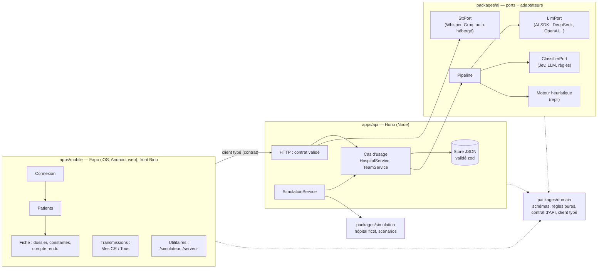
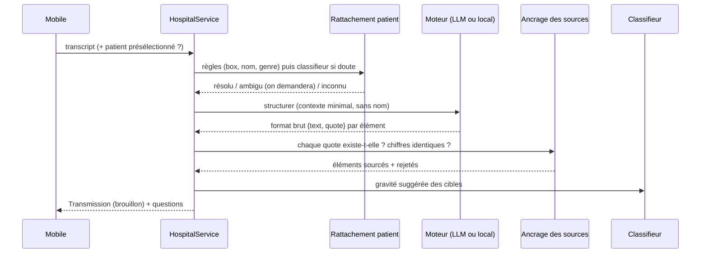

# Architecture

## Vue d'ensemble

## Paquets et règles de dépendance

| Paquet | Rôle | Dépend de |
| --- | --- | --- |
| `packages/domain` | Schémas zod, règles **pures** (ancrage, complétude, priorité, NEWS2, résumé d'équipe, fiche, temps, FHIR, recherche), contrat d'API + client | zod |
| `packages/ai` | Ports IA, adaptateurs, pipeline de structuration. **Serveur uniquement** | domain |
| `packages/simulation` | Hôpital fictif + scénarios (données) | domain |
| `apps/api` | Composition : services, store, HTTP, simulateur, CLI | domain, ai, simulation |
| `apps/mobile` | UI | domain (types + client) |
| `e2e` | Playwright | domain (client) |

Les paquets internes exposent leur **source TypeScript** (`main: src/index.ts`) : pas d'étape de build,
Metro, Vitest et tsx les consomment directement.

## Contrat d'API typé

`packages/domain/src/api/contract.ts` déclare chaque endpoint (méthode, chemin, schémas zod des
paramètres, query, corps et réponse).

- **Serveur** : `registerContract()` enregistre tout, valide les entrées (400 lisible) **et les sorties**
  (une réponse hors contrat = 500 + log). Le type `Handlers` oblige à implémenter chaque endpoint.
- **Client** : `createApiClient()` génère `api.<nom>(input)` typé ; la réponse est validée à l'exécution.
  Une dérive mobile/serveur casse immédiatement avec un message clair, pas silencieusement.

Endpoints ajoutés pour le front Bino (`apps/api/src/services/team-service.ts`, vues calculées par
`packages/domain/src/rules/{team,summary,news2}.ts`, testés dans `apps/api/src/http/team.test.ts`) :

| Nom | Route | Rôle |
| --- | --- | --- |
| `login` | POST `/session/login` | Connexion de démo : matricule d'un soignant du scénario chargé + `DEMO_PASSWORD` (401 sinon). Aucun jeton émis |
| `unitSummaries` | GET `/units/:unitId/summaries` | Onglet « Tous » : par patient présent, priorité (plancher NEWS2), NEWS2, puces sourcées du poste |
| `nurseReports` | GET `/nurses/:nurseId/reports` | « Mes CR » : CR du soignant sur la fenêtre de relève, du plus récent au plus ancien |
| `updateVitals` | PUT `/patients/:patientId/vitals` | Constantes saisies, horodatées et sourcées par le soignant ; renvoie le dossier recalculé |

`patientDetail` renvoie aussi `news2` et `devices` (jour de pose « J2 »). Le front utilise en plus
`config`, `session`, `unitBoard`, `patientDetail`, `samples`, `createTransmission`, `updatePriority`,
`health` et les endpoints du simulateur. Les autres (relecture, questions, fiche de relève,
recherche, récap, admission, export FHIR, horloge) restent disponibles sans écran : liste dans
[FONCTIONNEMENT.md §3](FONCTIONNEMENT.md#3-fonctions-gardées-dans-le-backend-mais-pas-affichées).

## Pipeline IA d'une dictée

Points clés :

- **Format brut commun** (`engine/raw.ts`) : tous les moteurs renvoient `{ text, quote }`. Le LLM ne
  produit jamais directement ce qui est affiché.
- **Ancrage** (`domain/rules/grounding.ts`) : l'extrait doit être retrouvé dans la dictée (tolérance
  accents/ponctuation/petites fautes) et **tous les nombres** du texte doivent figurer dans l'extrait.
  Sinon : rejet, tracé dans `engine.rejected`.
- **Repli** : délai max (`LLM_TIMEOUT_MS`) puis moteur heuristique ; la transmission porte
  `engine.degraded = true`, l'UI le dit.
- **Complétude** déterministe : cible sans R → question. Les questions d'imprécision du LLM sont
  limitées et toujours formulées en questions.
- **Priorité** : règles explicables (`PRIORITY_WEIGHTS`) + gravité suggérée (Jev Score / LLM / lexique)
  + **plancher NEWS2** sur la suggestion. Couleur manuelle et ★ priment toujours.
- **Fiche de relève** et **résumé « Tous »** : assemblés sans IA à partir des éléments sourcés des
  transmissions structurées (`rules/handover.ts`, `rules/summary.ts`).
- Le front Bino crée la transmission avec le patient présélectionné et ne la valide jamais :
  elle reste `draft` (DECISIONS P11).

## Temps

Tout est en heure locale du service via `Intl` (`rules/time.ts`), y compris sous Hermes.
`handoverWindow()` : pendant les 2 h qui suivent 7h45 / 19h45, on montre le poste qui vient de finir.
Cette fenêtre borne la fiche de relève, la priorité, « Mes CR » et « Tous ».
L'horloge peut être **simulée** (scénarios) : elle avance en temps réel depuis son point d'ancrage.
Le mobile affiche la date et les heures du serveur dans le fuseau du service, jamais celles de l'appareil.

## Persistance

Un seul document `HospitalState` (zod), en mémoire, sauvegardé en JSON (`DATA_DIR/state.json`,
écriture atomique différée). Un fichier incompatible avec le schéma est mis de côté, jamais écrasé.
Choix assumé pour le hackathon (zéro migration). Pour la production : implémenter le même store
sur Postgres hébergé HDS, sans toucher aux routes.

## Mobile

- **Expo SDK 58**, Expo Router (fichiers dans `src/app`), React Native Web pour le navigateur.
- Routes :

  | Route | Fichier | Rôle |
  | --- | --- | --- |
  | `/` | `index.tsx` | Redirige vers Patients si connecté, sinon Connexion |
  | `/connexion`, `/connexion-reussie` | `connexion.tsx`, `connexion-reussie.tsx` | Connexion de démo (`login`) |
  | `/patients`, `/transmissions` | `(app)/patients.tsx`, `(app)/transmissions.tsx` | Onglets ; `(app)/_layout.tsx` renvoie à Connexion sans session |
  | `/patient/[patientId]` | `patient/[patientId].tsx` | Fiche « Nouveau compte rendu », écran qui monte du bas |
  | `/serveur`, `/simulateur` | `serveur.tsx`, `simulateur.tsx` | Utilitaires, accessibles par l'URL seulement |

- Données serveur : **TanStack Query**. Rafraîchissement toutes les **5 s** (`unitBoard`,
  `patientDetail`, `nurseReports`, `unitSummaries`, `simulationStatus`), et au retour sur la
  fenêtre ; toute écriture invalide les vues.
- État local : **Zustand**. Session persistée (AsyncStorage : soignant, service, adresse de l'API,
  tris) ; brouillons de CR par patient **en mémoire seulement** (`features/report/drafts.ts`).
- Pas de bibliothèque de style : **tokens** (`src/ui/theme.ts`) + primitives maison, fiables sur
  toutes les plateformes. Identité Bino : [DESIGN.md](DESIGN.md).
- Dictée : enregistrement `expo-audio` + `/transcriptions` si un STT serveur est configuré → sinon
  Web Speech API (texte en direct, web seulement) → sinon micro du clavier (`src/lib/dictation-engine.ts`).
  Le texte reconnu s'ajoute à la fin du brouillon.
- Mise en page : une **colonne de 440 px** au plus, centrée (`COLUMN_MAX_WIDTH`, `src/app/_layout.tsx`),
  onglets en bas sur toutes les tailles d'écran. Pas de barre latérale ni de vue PC distincte
  (vérifié par `e2e/tests/bureau.spec.ts`).
- Logique de présentation pure (tris, formats, lignes du dossier, affichage NEWS2) dans `src/lib`,
  testée avec Vitest ; les règles métier (NEWS2, résumé, priorité) restent dans `packages/domain`.

## Sécurité (prototype)

- Clés uniquement côté serveur (`.env`, jamais dans l'app ni le dépôt ; hook de détection).
- Le LLM ne reçoit pas l'identité du patient (sexe, âge, motif seulement) — la dictée elle-même peut
  contenir un nom : pseudonymisation avant envoi = piste V2.
- CORS ouvert pour la démo : à restreindre au réseau de l'hôpital.
- Connexion de démo seulement : aucun jeton, chaque écriture porte un `nurseId` dont le serveur
  vérifie l'existence, pas l'identité de l'appelant. Authentification réelle (CPS / e-CPS) : V2.
