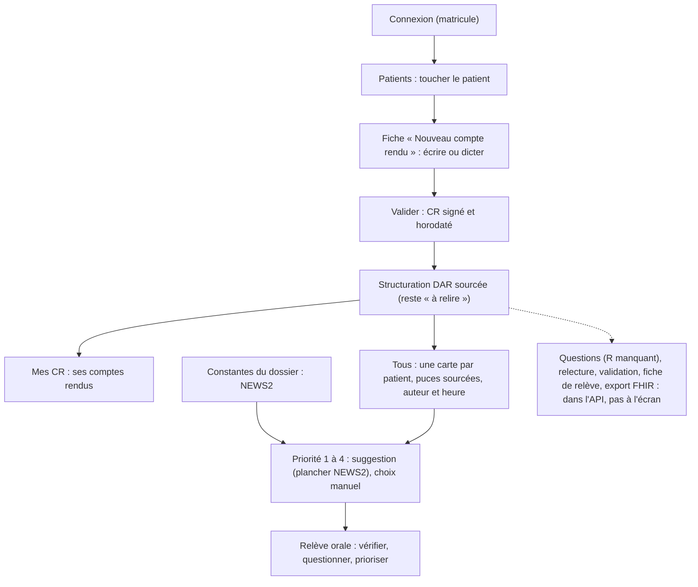

# Produit

Source : page Notion « Synthèse des échanges : problème, idées & pistes » (4 sessions du 13/11, tableau
de post-it) et « Kit d'immersion : transmissions et relèves infirmières (Foch) ». Ce document en garde
ce qui guide le code ; en cas de doute, la synthèse Notion fait foi.

## Question directrice

> Comment permettre à Martine de tracer ses soins en quelques secondes, au fil de l'eau, pour qu'à la
> relève l'information soit déjà prête, fiable et priorisée, sans lui ajouter une seule tâche ?

## Martine

- 43 ans, IDE en hôpital public, postes de **12 h** (7h45 → 19h45), relève deux fois par jour.
- Pas technophile, habitudes ancrées, ni le temps ni l'envie d'apprendre un outil.
- Valorise : le patient au centre, simplicité, rapidité, limiter l'erreur humaine, sa santé mentale.
- Rejette : un outil imposé, un outil qui **ajoute** une tâche, une IA pas fiable (« elle va écrire n'importe quoi »).
- **La « pizza »** : la relève est un moment collectif apprécié (questions, émotion). On ne la supprime pas.

## Le problème

1. **Perte de temps** : écrire, vérifier, engager sa responsabilité. Souvent après la fin du poste.
   « Du temps pour le faire » est le **premier besoin** cité par le terrain (kit Foch).
2. **Perte d'informations** : après 12 h, tout repose sur la mémoire, compressé en quelques minutes.
3. **Harmonisation** : chaque service, chaque soignant a sa façon de faire ; rien n'est comparable.

## Parcours implémenté (front « Bino »)

Le front suit les maquettes de l'équipe (DECISIONS P10). Détail écran par écran :
[FONCTIONNEMENT.md](FONCTIONNEMENT.md).

## Périmètre

✅ = à l'écran. 🟡 API = fait et testé dans l'API, pas affiché par le front Bino.

| Priorité (synthèse) | Fonction | État |
| --- | --- | --- |
| 🟩 Must | Bouton de dictée mobile, patient nommé en début de note | ✅ micro dans la fiche du patient (patient déjà choisi) : dictée en direct d'abord (texte pendant qu'elle parle, puis texte final retranscrit sur toute la dictée), sinon STT serveur à l'arrêt, sinon navigateur, sinon clavier. Capture native pas encore testée sur un appareil |
| 🟩 Must | Transcription robuste au jargon | ✅ lexique soignant partagé (prompt LLM, biais STT, moteur local) ; en direct, texte final retranscrit sur toute la dictée, nombres en chiffres (T23) |
| 🟩 Must | Rangement DAR + tri cible / soin de routine | ✅ à chaque « Valider » (LLM few-shot exemple A, moteur local de secours) ; repris en puces dans Tous, routine exclue |
| 🟩 Must | Champs manquants signalés, jamais inventés | ✅ jamais inventés : ancrage des sources + chiffres ; 🟡 API pour le signalement : R manquant → question sur la transmission, pas affichée (P16 : on ne challenge pas l'IDE) |
| 🟩 Must | Validation en 1 clic ou « non relu » | 🟡 API. Le front enregistre sans valider : la structuration reste « à relire » (P11) |
| 🟩 Must | Fiche de relève par patient + bloc transverse | ✅ carte Tous (puces sourcées) + dossier médical de la fiche ; 🟡 API pour la fiche complète par appareil ou sommaire |
| 🟨 Should | Vue service priorisée | ✅ Tous trié par priorité 1 → 4, choix manuel par les cercles ; 🟡 API pour l'étoile ★ |
| 🟨 Should | Mode admission → macro-cible d'entrée | 🟡 API |
| 🟨 Should | Export structuré type FHIR (simulé) | 🟡 API (Bundle R4, DPI simulé) |
| 🟦 Could | Récap « taille SMS » | 🟡 API |
| 🟦 Could | Questions en langage naturel, extraits sourcés | 🟡 API (recherche façon Ctrl+F, pas de chiffre affirmé) |
| Ajout Bino | Constantes et NEWS2 | ✅ points par paramètre, saisie avec score en direct, plancher de la priorité suggérée (P13) |
| Ajout Bino | Connexion par matricule | ✅ démo, mot de passe partagé (P14) ; CPS / e-CPS en V2 |
| 🟨 V2 | Détection des « non-dits », IA qui pose des questions d'incohérence | 🟡 API : questions d'imprécision par le LLM (2 demandées, 3 gardées au plus), pas d'analyse clinique ; non affichées |
| 🟨 V2 | Score de priorité automatique | 🟡 suggestion explicable (règles + gravité Jev/LLM + plancher NEWS2), l'IDE garde la main ; raison lue par le lecteur d'écran, pas affichée |
| 🟨 V2 | Continuité des cibles entre dictées (R dicté plus tard) | 🟡 API : la question « R manquant » se ferme si un CR ultérieur du poste apporte le résultat (vue, sans modifier l'original) ; non affichée |
| ⬜ Vision | Écoute continue, pin's, prédiction clinique, prescriptions | ⬜ pitch « et demain » |

## Indicateurs (kit Foch) et comment on les mesure

| Indicateur | Mesure dans le projet |
| --- | --- |
| Zéro information inventée | `pnpm sim eval` : chaînes interdites + éléments rejetés par l'ancrage |
| Taux de DAR complets (R rempli) | `darCompletionRate()` (domaine) |
| Bon patient | `pnpm sim eval` (« Bon patient ») |
| Corrections avant validation | `SourcedItem.edited` + source `nurse` (correction possible par l'API, pas d'écran dans le front Bino) |
| Temps de saisie | `engine.durationMs` ; `dictation.durationSec` existe mais le front Bino ne l'envoie pas |

Référence au 14/11, avant l'ajout de `chir-bino` : DeepSeek + Jev sur les 26 dictées de `rea-box12`,
`medecine-journee` et `admission-nuit` → **133/133 vérifications, 100 % bon patient, 0 invention**, ~2 s par dictée.

## Réglementaire (à dire au jury)

Données fictives uniquement. En cible : secret partagé (CSP L1110-4), RGPD, hébergement **HDS**,
information des patients sur l'enregistrement, analyse d'impact. L'outil reste sur **structuration et
synthèse sans interprétation clinique** pour ne pas basculer en dispositif médical. Le fournisseur
`openai-compatible` permet un LLM et un STT **auto-hébergés** (piste HDS).

**Exception assumée pour la démo : NEWS2** (DECISIONS P13). C'est un score clinique. Il est montré
comme une aide au calcul (entrées et points de chaque paramètre visibles) et ne sert que de plancher
à la priorité **suggérée** ; le choix manuel de l'IDE prime toujours. Un logiciel qui calcule un score
clinique pour prioriser des patients peut relever du règlement européen sur les dispositifs médicaux
(UE 2017/745) : à qualifier avant tout usage réel, ou à retirer.
