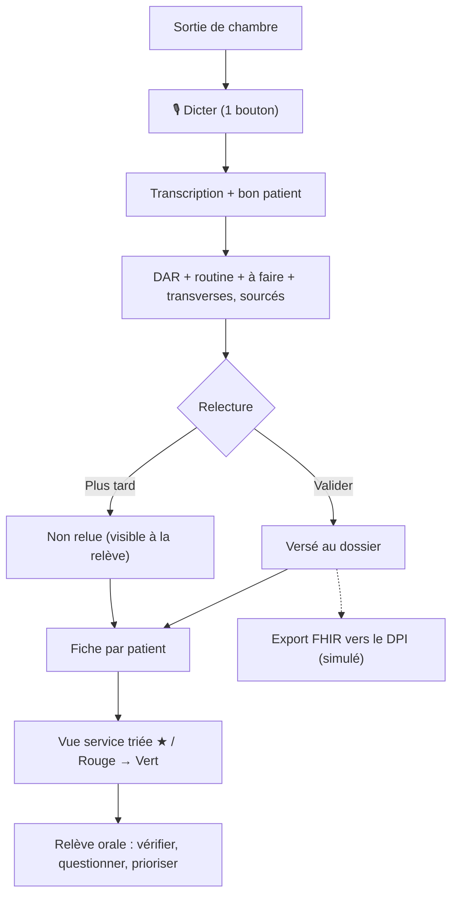

# Produit

Source : page Notion « Synthèse des échanges : problème, idées & pistes » (4 sessions du 13/11, tableau
de post-it) et « Kit d'immersion : transmissions et relèves infirmières (Foch) ». Ce document en garde
ce qui guide le code ; en cas de doute, la synthèse Notion fait foi.

## Question directrice

> Comment permettre à Martine de tracer ses soins en quelques secondes, au fil de l'eau, pour qu'à la
> relève l'information soit déjà prête, fiable et priorisée, sans lui ajouter une seule tâche ?

## Martine

- 43 ans, IDE en hôpital public, postes de **12 h** (7h45 → 19h45), relève deux fois par jour.
- Pas technophile, habitudes ancrées, ni le temps ni l'envie d'apprendre un outil.
- Valorise : le patient au centre, simplicité, rapidité, limiter l'erreur humaine, sa santé mentale.
- Rejette : un outil imposé, un outil qui **ajoute** une tâche, une IA pas fiable (« elle va écrire n'importe quoi »).
- **La « pizza »** : la relève est un moment collectif apprécié (questions, émotion). On ne la supprime pas.

## Le problème

1. **Perte de temps** : écrire, vérifier, engager sa responsabilité. Souvent après la fin du poste.
   « Du temps pour le faire » est le **premier besoin** cité par le terrain (kit Foch).
2. **Perte d'informations** : après 12 h, tout repose sur la mémoire, compressé en quelques minutes.
3. **Harmonisation** : chaque service, chaque soignant a sa façon de faire ; rien n'est comparable.

## Parcours cible (implémenté)

## Périmètre

| Priorité (synthèse) | Fonction | État |
| --- | --- | --- |
| 🟩 Must | Bouton de dictée mobile, patient nommé en début de note | ✅ web (texte en direct), natif (STT serveur), clavier |
| 🟩 Must | Transcription robuste au jargon | ✅ lexique soignant partagé (prompt LLM, biais STT, moteur local) |
| 🟩 Must | Rangement DAR + tri cible / soin de routine | ✅ LLM (few-shot exemple A) + moteur local de secours |
| 🟩 Must | Champs manquants signalés, jamais inventés | ✅ R manquant → question ; ancrage des sources + chiffres |
| 🟩 Must | Validation en 1 clic ou « non relu » | ✅ |
| 🟩 Must | Fiche de relève par patient + bloc transverse | ✅ par appareil (réa) ou sommaire (service) |
| 🟨 Should | Vue service priorisée (couleurs + ★) sur le web | ✅ maître-détail, mode réunion, rafraîchie en continu |
| 🟨 Should | Mode admission → macro-cible d'entrée | ✅ |
| 🟨 Should | Export structuré type FHIR (simulé) | ✅ Bundle R4, DPI simulé |
| 🟦 Could | Récap « taille SMS » | ✅ copiable |
| 🟦 Could | Questions en langage naturel, extraits sourcés | ✅ recherche façon Ctrl+F (pas de chiffre affirmé) |
| 🟨 V2 | Détection des « non-dits », IA qui pose des questions d'incohérence | 🟡 questions d'imprécision par le LLM (max 2), pas d'analyse clinique |
| 🟨 V2 | Score de priorité automatique | 🟡 suggestion explicable (règles + gravité Jev/LLM), l'IDE garde la main |
| 🟨 V2 | Continuité des cibles entre dictées (R dicté plus tard) | 🟡 fiche et priorité : la question « R manquant » se ferme si une dictée ultérieure apporte le résultat (vue, sans modifier l'original) |
| ⬜ Vision | Écoute continue, pin's, prédiction clinique, prescriptions | ⬜ pitch « et demain » |

## Indicateurs (kit Foch) et comment on les mesure

| Indicateur | Mesure dans le projet |
| --- | --- |
| Zéro information inventée | `pnpm sim eval` : chaînes interdites + éléments rejetés par l'ancrage |
| Taux de DAR complets (R rempli) | `darCompletionRate()` (domaine) |
| Bon patient | `pnpm sim eval` (« Bon patient ») |
| Corrections avant validation | `SourcedItem.edited` + source `nurse` |
| Temps de saisie | `dictation.durationSec`, `engine.durationMs` |

Référence au 14/11 : DeepSeek + Jev sur 26 dictées → **133/133 vérifications, 100 % bon patient, 0 invention**, ~2 s par dictée.

## Réglementaire (à dire au jury)

Données fictives uniquement. En cible : secret partagé (CSP L1110-4), RGPD, hébergement **HDS**,
information des patients sur l'enregistrement, analyse d'impact. L'outil reste sur **structuration et
synthèse sans interprétation clinique** pour ne pas basculer en dispositif médical. Le fournisseur
`openai-compatible` permet un LLM et un STT **auto-hébergés** (piste HDS).
